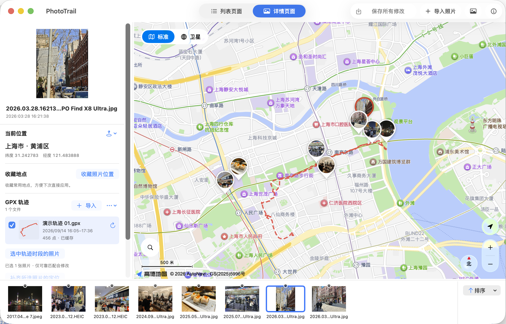
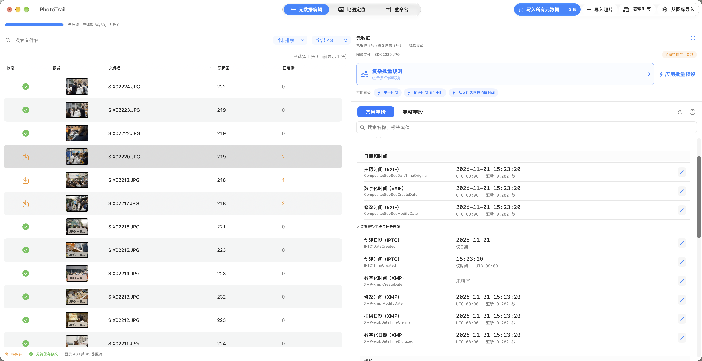
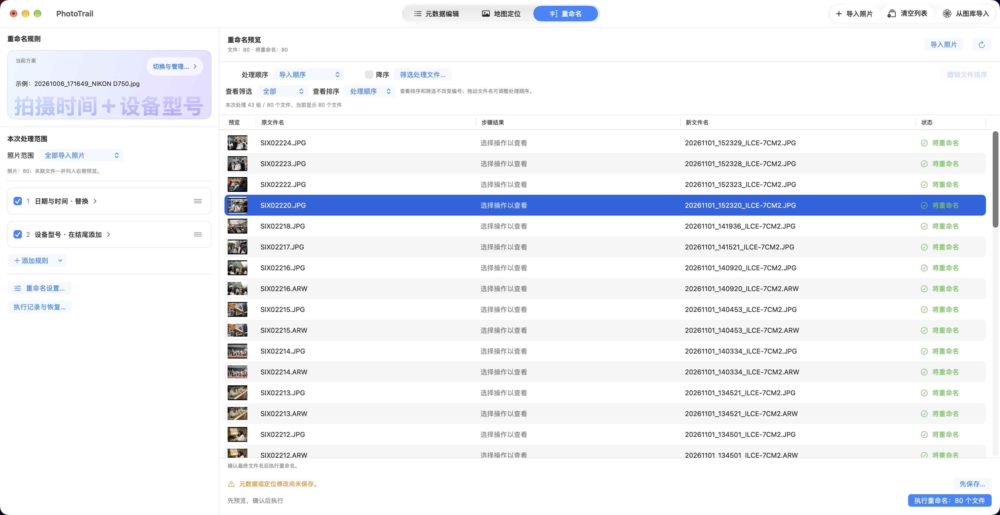

[简体中文](../../README.md) · [English](../../docs/i18n/README.en.md) · [繁體中文](../../docs/i18n/README.zh-Hant.md) · [日本語](../../docs/i18n/README.ja.md) · [한국어](../../docs/i18n/README.ko.md) · [Español](../../docs/i18n/README.es.md) · **Português do Brasil**

# PhotoTrail

Dê às fotos um lugar na sua viagem.

PhotoTrail é uma ferramenta gratuita para organizar fotos no macOS. Adicione locais, corrija datas e créditos e transforme nomes dispersos em uma sequência clara. Importe uma vez e combine os três fluxos ou use apenas o que precisar.

| Seu objetivo | O que o PhotoTrail oferece |
| --- | --- |
| Recuperar locais | Associar o trajeto da viagem e ajustar pontos no mapa |
| Completar informações | Corrigir datas e adicionar autoria, direitos e palavras-chave |
| Organizar nomes | Combinar datas, locais e sequências, mantendo arquivos relacionados juntos |

## Prévia

## Três formas de organizar suas fotos

### 1. Trajetos e localização no mapa

**Registre a viagem mesmo com uma câmera sem GPS.**

- **Localizar pelo trajeto:** importe GPX, KML ou KMZ com horários, associe às datas de captura e confira antes de aplicar.
- **Ajustar no mapa:** use Apple Maps ou AMap para buscar, salvar favoritos, mover marcadores ou definir um local para várias fotos.
- **Criar trajetos com fotos:** gere GPX a partir de fotos localizadas ou exporte cópias com localização e um relatório de verificação.

Também é possível completar dados de região, como estado e cidade. Rotas sem horários por ponto servem apenas para visualização. A associação respeita os segmentos e o período registrado.

### 2. Consulta e edição de metadados

**Coloque datas, autoria e direitos em ordem.**

- **Crie regras e use na tela principal:** edite operações em lote no próprio local, com a comparação recolhida por padrão. Salve regras como predefinição, ajuste os parâmetros na tela principal e aplique a todas as fotos importadas. Somente “Atualizar predefinição” salva as mudanças de parâmetros.
- **Encontrar e editar:** busque informações EXIF, IPTC, XMP e outras por nome, tag ou valor; edite campos comuns diretamente.
- **Começar com um preset:** adicione uma hora, recupere datas pelos nomes, alinhe campos de data (incluindo criação e modificação do arquivo) ou preencha autor e direitos ausentes.
- **Combinar regras:** organize atribuições, cópias de campos e ajustes de tempo e salve como preset. Descreva datas no nome com `YYYY`, `MM`, `DD` e outros símbolos, sem expressões regulares.

Edite individualmente ou em lote JPEG, HEIC/HEIF, PNG, TIFF, WebP, AVIF, GIF, PSD/PSB, JPEG 2000 (JP2), JPEG XL, RAW compatíveis e XMP existentes. Os campos graváveis variam por formato; outras imagens estáticas podem ser importadas para consulta. Veja a [tabela de formatos](../FORMATS.md) (em chinês).

### 3. Renomeação em lote

**Troque números de câmera por nomes reconhecíveis.**

- **Campos ausentes:** por padrão, pula a regra afetada e mantém os outros resultados. Nas configurações, você pode optar por manter o nome original.
- **Monte seu formato:** combine datas, locais, equipamentos, texto e sequências; arraste para ordenar as regras.
- **Confira antes:** visualize nomes antigos, novos e conflitos de todas as fotos ou de uma seleção.
- **Mantenha os vínculos:** processe JPG, RAW e XMP associados. Salve esquemas e restaure nomes pelo registro de execução se os arquivos não tiverem mudado.

Salve as alterações das fotos antes de renomear. Há um modo compatível com ExFAT; permissões de pasta e espaço adicional são explicados na [documentação detalhada](../BEHAVIOR.md).

## Salvar alterações

**Confira primeiro. Grave quando estiver pronto.** Navegar, editar e aplicar presets não altera os arquivos imediatamente. É possível desfazer antes de salvar.

Por padrão, Salvar todos os metadados (⌘S) grava localização e campos juntos, independentemente da seleção ou dos filtros. Nos ajustes, você pode limitar à página atual. O salvamento local segue a configuração de backup e verifica por releitura, sem recomprimir pixels. Alterações que falham continuam pendentes.

A fototeca da Apple usa a interface do sistema apenas para localização e data, com limites de edição e backup diferentes. Pares JPG + RAW podem compartilhar localização; outros campos não são copiados automaticamente.

## Primeiros passos

1. **Importe:** abra ou arraste fotos e confira o horário de captura e o fuso da câmera.
2. **Adicione locais:** revise a associação ao trajeto ou escolha um ponto no mapa.
3. **Complete os dados:** edite campos ou aplique um preset.
4. **Salve:** confira e grave as alterações; depois visualize e execute a renomeação se necessário.

Cada fluxo funciona sozinho. Remover fotos da lista não apaga arquivos; exportar cópias não sobrescreve os originais.

## Muitas fotos e cache

A importação mostra progresso e tempo restante estimado; miniaturas carregam sob demanda. Ajustes, favoritos e cache de trajetos são preservados. Os caches de miniaturas e leitura de metadados são refeitos na próxima abertura.

## Idiomas

Disponível em chinês simplificado, English, 繁體中文, 日本語, 한국어, Español e Português do Brasil. Altere nos ajustes, salve o trabalho e reabra o aplicativo.

A configuração inicial sugere AMap para chinês simplificado e Apple Maps para os demais idiomas; você pode escolher outro. O idioma não altera as datas das fotos. O idioma do mapa depende do provedor.

## Download e instalação

[Baixar a versão mais recente](https://github.com/LittleSixNine/PhotoTrail/releases/latest) · [Histórico de versões](https://github.com/LittleSixNine/PhotoTrail/releases)

Requer **macOS 14 ou posterior**, em Apple silicon ou Intel. Abra o DMG, encerre o PhotoTrail e arraste o aplicativo para Aplicativos.

O software é gratuito. Os pacotes atuais ainda não têm assinatura Developer ID nem notarização da Apple, por isso o macOS pode bloquear a primeira abertura. O download automático de atualizações vem desativado; a instalação é manual.

## Serviço AMap e custos

O AMap exige sua própria Web JS API Key e securityJsCode, armazenados no Chaves do macOS. O Apple Maps não exige credenciais AMap.

Serviços pagos ou uso além da franquia gratuita são cobrados pelo AMap na sua conta de desenvolvedor. O PhotoTrail é gratuito e não cobra tarifas de mapas.

## Coordenadas e privacidade

- **As fotos são processadas localmente.** O AMap recebe buscas e coordenadas relacionadas ao mapa. Exibir trajetos sem cache ou atualizar a conversão também envia as coordenadas necessárias do trajeto.
- **Coordenadas do mapa e das fotos são distintas.** Pontos confirmados no AMap são verificados e convertidos para WGS84; novos pontos ficam restritos à China continental com validação administrativa. Fotos sem sistema declarado são apenas exibidas provisoriamente como WGS84, sem reescrita automática.
- **Trajetos originais são preservados.** A conversão não muda a fonte; a associação temporal usa os dados WGS84 originais. A verificação não garante a precisão do GPS ou do ponto escolhido.

## Origem do projeto

O PhotoTrail começou adicionando localização a fotos de câmera e digitalizações de filme e passou a incluir metadados e nomes. Parte do processamento deriva de [marchyman/GeoTag](https://github.com/marchyman/GeoTag).

## Skill para agentes

Use um agente sem abrir o aplicativo Mac. O [PhotoTrail Skill](../../skill/) independente gera GPX a partir de fotos ou adiciona localização com GPX, criando cópias JPEG/HEIC e um relatório, sem modificar os originais.

### Instalação

Envie isto a um agente capaz de acessar arquivos locais e executar comandos:

> Leia https://raw.githubusercontent.com/LittleSixNine/PhotoTrail/phototrail/skill/INSTALL.md , instale o PhotoTrail Skill conforme as instruções e confira o ambiente de execução.

Requer **Python 3.11+ e ExifTool**; verificado no macOS. Não acessa busca de mapas ou a fototeca da Apple e não grava RAW/XMP. Veja o [guia de uso](SKILL.pt-BR.md) e a [referência de parâmetros](../../skill/SKILL.md).

## Desenvolvimento

Requer Xcode completo (Swift 6.3+, SDK macOS 26+), XcodeGen e SwiftLint. Veja o [guia de desenvolvimento](DEVELOPMENT.en.md) para compilar e testar e os [limites funcionais](../BEHAVIOR.md).

## Agradecimentos e licença

Obrigado a Marco S Hyman, autor do [GeoTag](https://github.com/marchyman/GeoTag), e a projetos como o [ExifTool](https://exiftool.org/).

Uso pessoal e profissional e redistribuição gratuita são permitidos. Cobrar pela distribuição ou pelo acesso ao software exige autorização por escrito. Veja a [licença](../../LICENSE) e os [avisos de terceiros](../../THIRD_PARTY_NOTICES.md). É um projeto derivado independente, sem vínculo oficial com Apple ou AMap.
